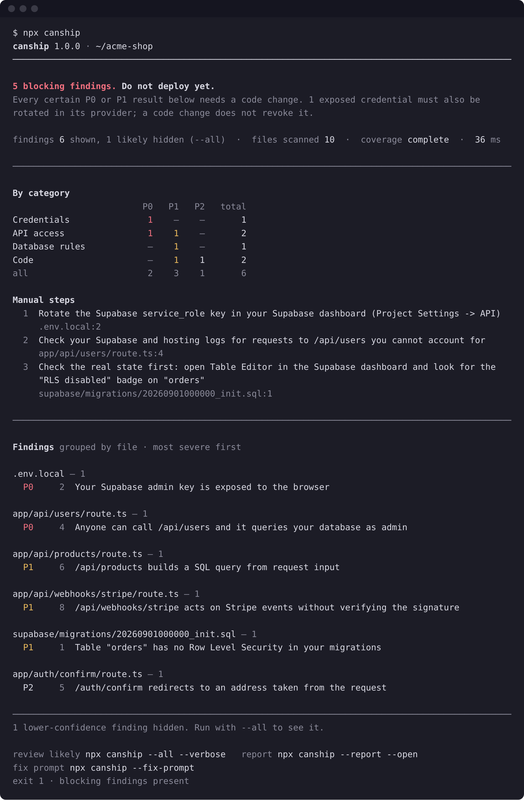
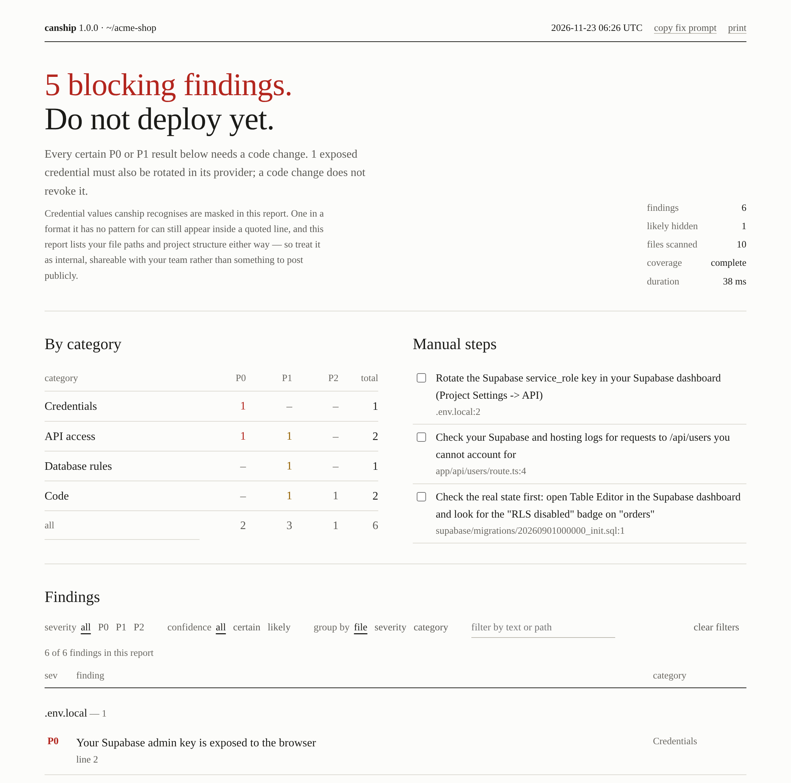

# canship

面向 JavaScript / TypeScript Web 应用的上线前安全检查。查找泄露的凭据、缺失的访问控制和不安全的请求输入处理。静态扫描只读取本地文件，不执行项目代码，也不访问网络。

[English](./README.md) · [使用参考](./docs/reference-zh-CN.md) · [发布说明](https://github.com/Tasomei/canship/releases) · [npm](https://www.npmjs.com/package/canship)

本文适用于 `1.0.0`（`latest`）。

## 快速开始

要求 Node.js 18 及以上，无运行时依赖。

```powershell
npx canship@1.0.0
```

也可以指定扫描目录。

```powershell
npx canship@1.0.0 "./my-app"
```



## 检测范围

| 检查项 | 示例 |
|---|---|
| 凭据 | 硬编码密钥、公开环境变量、Git 历史 |
| 访问控制 | API 鉴权、Supabase RLS、Firebase 规则 |
| 请求输入 | SQL、Shell 命令、文件路径、外部请求和重定向地址 |
| CORS | 携带凭据时使用通配符或回显来源 |

路由分析支持指定的 Express、Hono 和 Fastify 工厂函数，包括带参数的工厂。见[支持的框架与入口](./docs/reference-zh-CN.md#服务端入口)。

```powershell
npx canship@1.0.0 --list-rules
```

## 审阅结果

默认显示 `certain` 结果。用 `--all` 查看需要人工审阅的 `likely` 结果。

```powershell
npx canship@1.0.0 --all --verbose
```

```powershell
npx canship@1.0.0 --all --report
```



详细报告可能包含路径和源码摘录。用 `--no-excerpts` 省略源码摘录，或用 `--share-summary` 只分享计数。

| 退出码 | 含义 |
|---|---|
| `0` | 无结果，且覆盖完整（或经 `--best-effort` 接受不完整覆盖） |
| `1` | 至少一条 `certain` 的 P0/P1 结果 |
| `2` | 其他结果，包括被隐藏的 `likely` |
| `3` | 输入无效、工具错误或覆盖不完整 |

## 接入 CI

保存为 `.github/workflows/canship.yml`：

```yaml
name: canship
on: [push, pull_request]
permissions:
  contents: read
jobs:
  scan:
    runs-on: ubuntu-latest
    steps:
      - uses: actions/checkout@d23441a48e516b6c34aea4fa41551a30e30af803
        with:
          fetch-depth: 0
          persist-credentials: false
      - uses: Tasomei/canship@07cd42b502108fa97eb1f341dea0252802b18f53
        with:
          version: '1.0.0'
          honor-ignore-markers: false
```

Action 只安装指定版本的扫描器，并输出计数摘要。扫描不完整或工具出错时任务失败。SARIF 上传需显式开启。

| 输入 | 固定 Action 的默认值 | 含义 |
|---|---|---|
| `version` | `1.0.0` | 精确的 npm 扫描器版本；请如上例显式设置 |
| `fail-on` | `blocking` | `blocking`：`certain` 的 P0/P1；`any`：全部结果；`none`：仅报告 |

完整说明见 [Action 输入](https://github.com/Tasomei/canship/blob/07cd42b502108fa97eb1f341dea0252802b18f53/action.yml)。

## 参考

- [命令行选项、基线和报告比较](./docs/reference-zh-CN.md#命令行)
- [工作区与配置](./docs/reference-zh-CN.md#配置)
- [可选部署校验](./docs/reference-zh-CN.md#部署校验)
- [隐私与覆盖限制](./docs/reference-zh-CN.md#隐私与限制)
- [JavaScript API](./docs/reference-zh-CN.md#api-与结构化输出)及 [VS Code 扩展预览版](https://github.com/Tasomei/canship/tree/main/extensions/vscode#readme)

## 开发与许可

见[开发参考](./docs/reference-zh-CN.md#开发)。采用 [MIT](./LICENSE) 许可；Supabase 与 Firebase 测试夹具保留 Apache-2.0，Next.js 与 `cors` 夹具保留 MIT。
