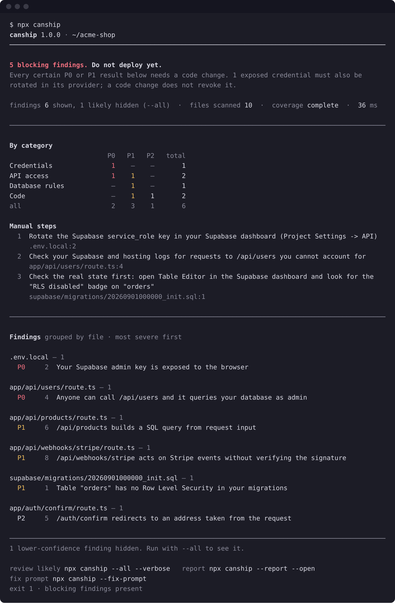
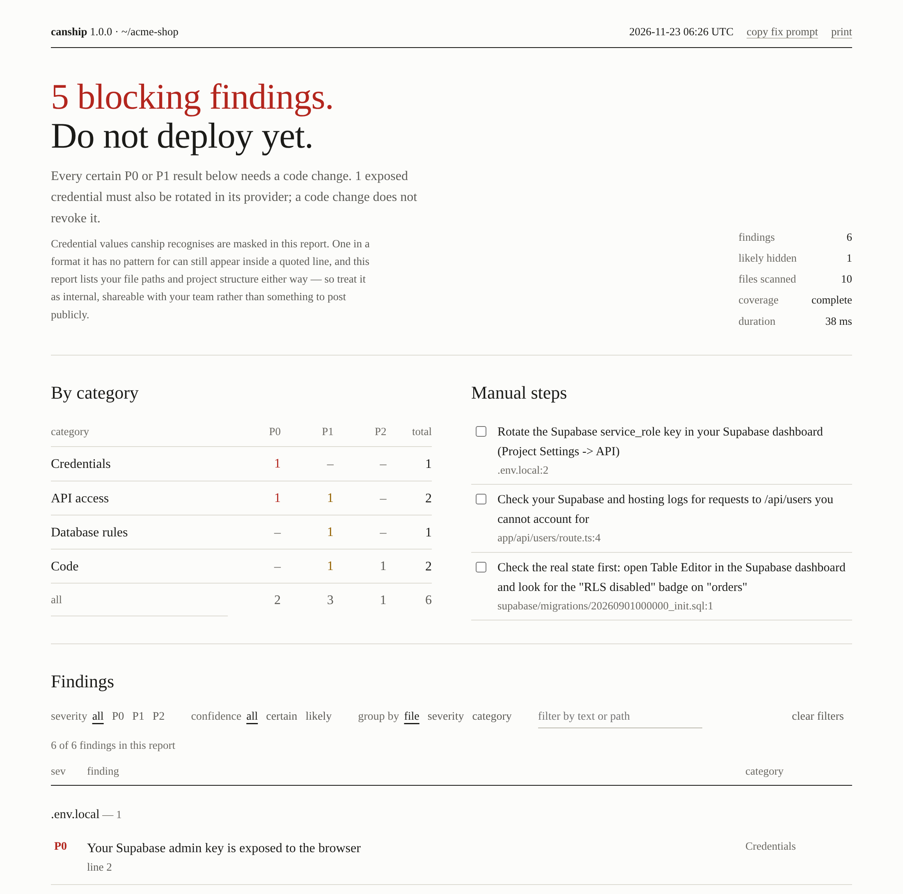

# canship

Pre-deployment security checks for JavaScript and TypeScript web apps. Find exposed credentials, missing access controls, and unsafe handling of request input. Static scans read local files without running project code or accessing the network.

[简体中文](./README-zh-CN.md) · [Reference](./docs/reference.md) · [Releases](https://github.com/Tasomei/canship/releases) · [npm](https://www.npmjs.com/package/canship)

This guide covers `1.0.0` (`latest`).

## Quick start

Requires Node.js 18 or later; no runtime dependencies.

```powershell
npx canship@1.0.0
```

Pass a directory to scan it explicitly.

```powershell
npx canship@1.0.0 "./my-app"
```



## Checks

| Check | Examples |
|---|---|
| Credentials | Hardcoded secrets, public environment variables, Git history |
| Access control | API authentication, Supabase RLS, Firebase rules |
| Request input | SQL, shell commands, file paths, outbound URLs and redirects |
| CORS | Wildcard or reflected origins with credentials |

Route analysis covers selected Express, Hono and Fastify factories, including factories with parameters. See [supported frameworks and entry points](./docs/reference.md#server-entry-points).

```powershell
npx canship@1.0.0 --list-rules
```

## Reviewing findings

The default view shows `certain` findings. Use `--all` to include `likely` findings for manual review.

```powershell
npx canship@1.0.0 --all --verbose
```

```powershell
npx canship@1.0.0 --all --report
```



Detailed reports may contain paths and source excerpts. Use `--no-excerpts` to omit source or `--share-summary` to share counts only.

| Exit code | Meaning |
|---|---|
| `0` | No findings, with complete coverage (or incomplete coverage accepted via `--best-effort`) |
| `1` | At least one `certain` P0/P1 finding |
| `2` | Other findings, including hidden `likely` findings |
| `3` | Invalid input, tool error, or incomplete coverage |

## Continuous integration

Save as `.github/workflows/canship.yml`:

```yaml
name: canship
on: [push, pull_request]
permissions:
  contents: read
jobs:
  scan:
    runs-on: ubuntu-latest
    steps:
      - uses: actions/checkout@d23441a48e516b6c34aea4fa41551a30e30af803
        with:
          fetch-depth: 0
          persist-credentials: false
      - uses: Tasomei/canship@07cd42b502108fa97eb1f341dea0252802b18f53
        with:
          version: '1.0.0'
          honor-ignore-markers: false
```

The Action installs only the pinned scanner and writes a counts-only summary. Incomplete scans and tool errors fail the job. SARIF upload is opt-in.

| Input | Default in the pinned Action | Meaning |
|---|---|---|
| `version` | `1.0.0` | Exact npm scanner version; set explicitly as above |
| `fail-on` | `blocking` | `blocking`: `certain` P0/P1; `any`: all findings; `none`: report only |

See all [Action inputs](https://github.com/Tasomei/canship/blob/07cd42b502108fa97eb1f341dea0252802b18f53/action.yml).

## Reference

- [CLI options, baselines and comparisons](./docs/reference.md#cli)
- [Workspaces and configuration](./docs/reference.md#configuration)
- [Opt-in deployment probes](./docs/reference.md#deployment-probes)
- [Privacy and coverage limits](./docs/reference.md#privacy-and-limits)
- [JavaScript API](./docs/reference.md#api-and-structured-output) and [VS Code extension preview](https://github.com/Tasomei/canship/tree/main/extensions/vscode#readme)

## Development and license

See the [development reference](./docs/reference.md#development). Licensed under [MIT](./LICENSE); Supabase and Firebase test fixtures retain Apache-2.0, and Next.js and `cors` fixtures retain MIT.
